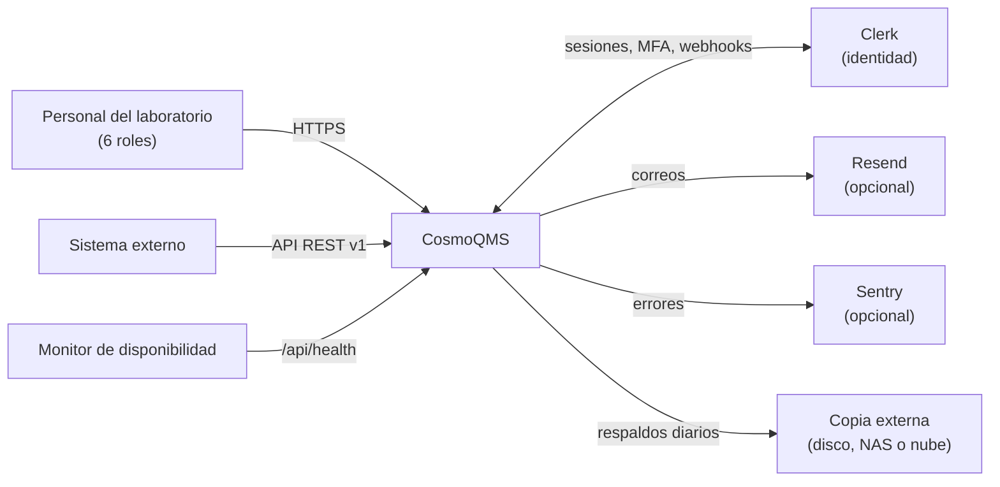
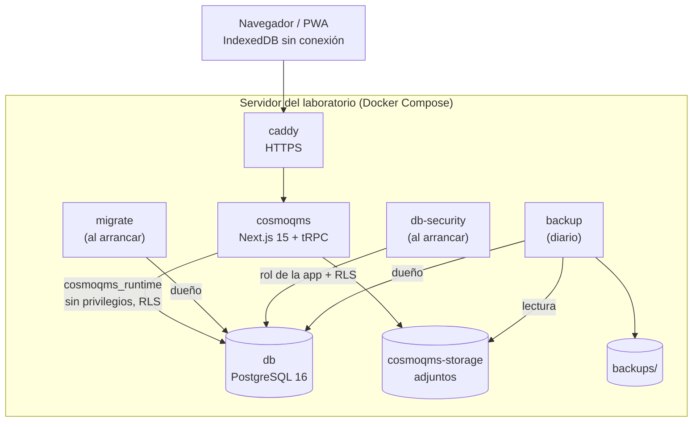
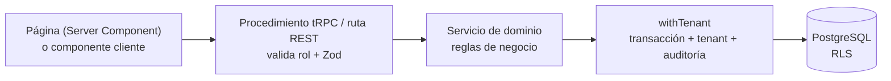
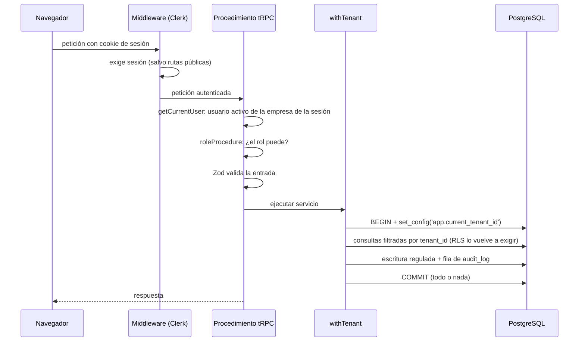
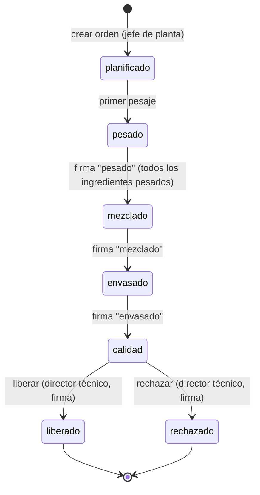
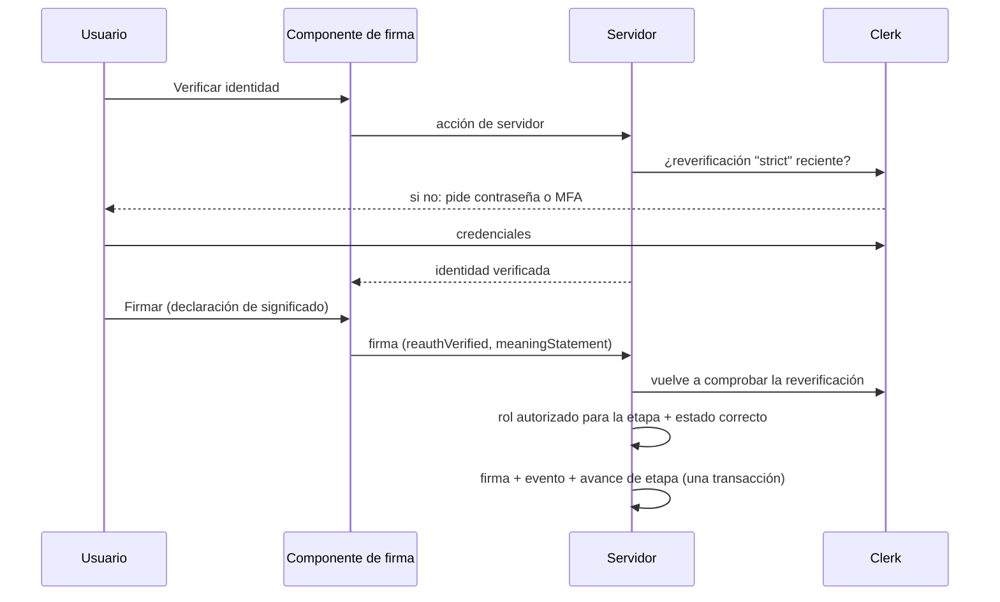
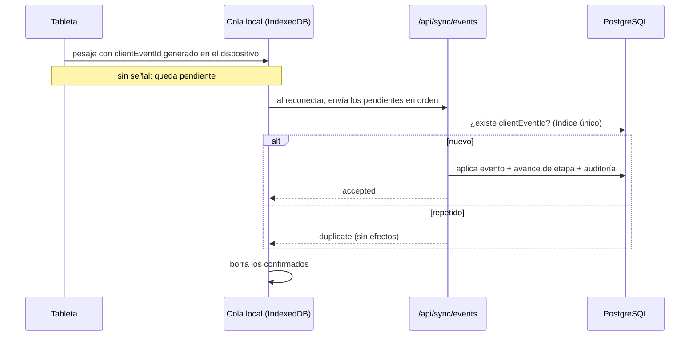

# Manual arquitectónico de CosmoQMS

Versión 1.0 · Explica cómo está organizado CosmoQMS y por qué. Los diagramas
están en Mermaid (GitHub y la mayoría de editores Markdown los dibujan).
Detalle de tecnologías y configuración: [manual técnico](02-manual-tecnico.md).

## 1. Objetivos de la arquitectura

| Objetivo | Cómo se logra |
|---|---|
| Integridad de datos BPM (ALCOA+) | Audit trail transaccional, eventos de lote solo de inserción, firmas con reautenticación |
| Aislamiento entre empresas | Doble barrera: filtro en la aplicación y Row Level Security en la base |
| Trabajo en planta sin señal | Cola local en el dispositivo y sincronización idempotente |
| Reglas que no dependan del cliente | Toda decisión (etapas, veredictos, permisos) se toma en el servidor |
| Datos bajo control del laboratorio | Base de datos propia en Docker; solo la identidad es un servicio externo |
| Cambios controlados | Monolito modular con pruebas automatizadas y CI en cada cambio |

## 2. Contexto



## 3. Contenedores



Orden de arranque: `db` sano → `migrate` → `db-security` → `cosmoqms` → `caddy`.
La app nunca arranca con migraciones pendientes ni sin la seguridad aplicada.

## 4. Estructura del código

Monolito modular: un solo despliegue, con un módulo por dominio de negocio.

```
src/
├── app/
│   ├── (app)/                  pantallas protegidas, una carpeta por módulo
│   │   ├── materias-primas/  formulas/  produccion/  calidad/
│   │   ├── trazabilidad/  reportes/  sops/  auditoria/
│   │   └── usuarios/  configuracion/  notificaciones/  dashboard/
│   ├── (auth)/                 login y "sin acceso"
│   └── api/                    REST v1, reportes, PDF, adjuntos, sync, webhooks, health
├── components/                 por dominio: batch/, quality/, production/, layout/...
└── lib/
    ├── trpc/router/            un router por dominio, unidos en _app.ts
    ├── validation/             esquemas Zod (sin dependencias de servidor)
    ├── production/ quality/ formulas/ sops/ users/ materials/ reports/
    ├── offline/                cola Dexie y motor de sincronización (aislado)
    ├── db.ts  audit.ts         withTenant y audit trail
    └── auth.ts  pageAccess.ts  reauth.ts   sesión, permisos, firma
prisma/schema.prisma            modelo de datos (fuente de verdad)
db/                             rol de la app, RLS y scripts de respaldo
```

Capas de cada módulo:



- **Lecturas de pantalla**: los Server Components leen directo con
  `withTenant` (sin pasar por la red).
- **Escrituras e interacción**: componentes cliente con tRPC y TanStack Query.
- **Esquemas en `lib/validation/`**: no importan nada del servidor, así que los
  formularios del navegador los reutilizan sin arrastrar Prisma al cliente.

## 5. Flujo de una petición



## 6. Decisiones clave

### 6.1 Aislamiento por empresa en dos barreras

Cada consulta filtra por `tenant_id` en el código **y** la base aplica Row
Level Security forzado en las 18 tablas, con la empresa tomada de
`app.current_tenant_id`, que `withTenant` fija al abrir cada transacción. La app
se conecta con `cosmoqms_runtime`, un rol sin superusuario ni BYPASSRLS que no
es dueño de las tablas; el dueño (`cosmoqms_app`) solo migra y respalda. Un
error en una de las dos barreras no expone datos de otra empresa.

### 6.2 Audit trail en la misma transacción

`withAuditLog` (`src/lib/audit.ts`) es una extensión de Prisma que intercepta
toda escritura sobre las tablas reguladas, toma una foto del registro antes y
después y escribe `audit_log` con la misma transacción. Si la auditoría falla,
la escritura se deshace. Los cambios de usuarios, SOPs y datos de la empresa
se auditan explícitamente en sus servicios.

### 6.3 Inmutabilidad: corregir es agregar

`batch_events`, `audit_log` y `attachments` solo admiten inserción: no hay
políticas RLS de `UPDATE`/`DELETE` y el rol de la app no tiene esos privilegios.
Una corrección es un evento nuevo que compensa al anterior; un documento de SOP
aprobado no cambia, se crea una versión nueva.

### 6.4 Máquina de estados del lote en el servidor



`src/lib/production/stateMachine.ts` define las transiciones; el servidor lee
el estado actual de la base, nunca el que envía el navegador, y la escritura
lleva el estado esperado en su `WHERE` para que dos firmas simultáneas no
avancen dos veces. La liberación además exige resultados de QC para cada
parámetro especificado, ninguno no conforme y ninguna desviación abierta.

### 6.5 Firma electrónica



El indicador `reauthVerified` que manda el navegador nunca basta: el servidor
vuelve a preguntarle a Clerk (`src/lib/reauth.ts`). El mismo patrón firma
etapas, libera o rechaza lotes y aprueba SOPs.

### 6.6 Sin conexión e idempotencia



### 6.7 Identidad delegada

Clerk gestiona contraseñas, MFA, sesiones y reverificación; CosmoQMS no guarda
credenciales. Un webhook firmado (Svix) crea los usuarios y sincroniza el
estado de MFA. El **rol** y el estado activo los decide CosmoQMS (pantalla
Usuarios, con auditoría): el webhook nunca los sobrescribe.

### 6.8 Base de datos propia

PostgreSQL en el mismo servidor, sin proveedor administrado: los registros BPM
quedan bajo control del laboratorio, con respaldos propios verificados. A
cambio, el laboratorio asume la operación (ver
[manual de administrador](05-manual-de-administrador.md)).

## 7. Seguridad por capas

| Capa | Control |
|---|---|
| Red | Solo 80/443 expuestos; la base escucha en `127.0.0.1` |
| Transporte | HTTPS (Caddy), HSTS y cabeceras de seguridad |
| Identidad | Clerk con MFA; cuentas personales |
| Aplicación | Middleware que exige sesión; rol validado en cada página, procedimiento y ruta |
| Datos | Zod en toda entrada; tipos de archivo verificados por contenido |
| Base de datos | Rol sin privilegios, RLS forzado, tablas append-only |
| Operación | Secretos fuera del código, respaldos verificados, CI con verificación de seguridad |

## 8. Atributos de calidad

| Atributo | Decisión |
|---|---|
| Mantenibilidad | Un módulo por dominio, sin imports cruzados entre routers; componentes de máximo 300 líneas; TypeScript estricto sin `any` |
| Verificabilidad | Reglas en funciones puras probadas (máquina de estados, tolerancias, especificaciones); 315 pruebas unitarias y 42 E2E |
| Disponibilidad | Healthchecks y reinicio automático de contenedores; monitor externo |
| Rendimiento | Paginación en el servidor (25 por página, 50 en auditoría); índices por `tenant_id` |
| Usabilidad en planta | Diseño mobile-first, botones de al menos 44 px, PWA instalable |
| Escalabilidad | Una instalación por laboratorio; el modelo ya es multiempresa |

## 9. Evolución prevista

- Habilitar varias empresas en la interfaz (el modelo y la RLS ya lo soportan).
- Ampliar la API REST v1 a más módulos, con el mismo contrato OpenAPI y pruebas.
- Toda evolución pasa por control de cambios y por la validación afectada
  ([plan maestro](validacion/01-plan-maestro-validacion.md)).
